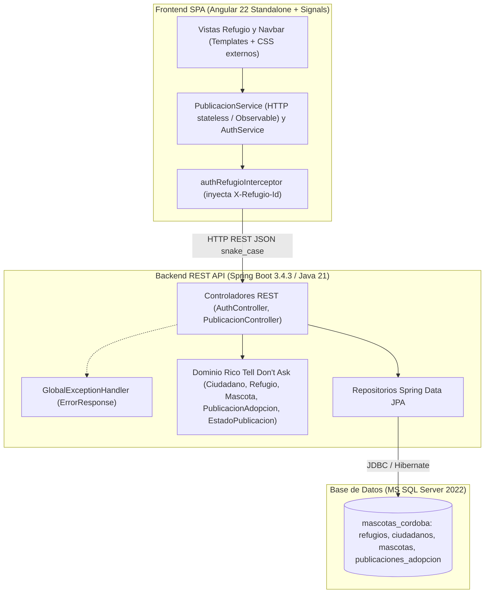
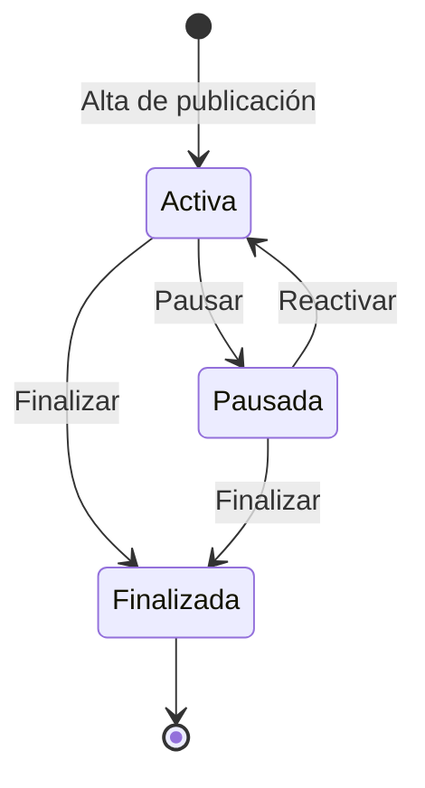

# Mascotas Córdoba

Plataforma web del **Programa Municipal de Bienestar Animal**, desarrollada para la asignatura **Diseño Avanzado de Software (DAS)** (10° Cuatrimestre, Ingeniería en Informática - Plan 2014, **Universidad Blas Pascal**).

---

## 1. Alcance Funcional (Parcial III)

El alcance implementado cubre de forma exclusiva el **Perfil Refugio**:

### RF15 - Autenticación de Usuarios (Perfil Refugio)
* **Autenticación interna**: Ingreso directo mediante **CUIL y contraseña** validados contra la tabla `ciudadanos` (sin integración con CiDi en esta instancia).
* **Control de acceso**: El dominio verifica que el ciudadano esté habilitado, cuente con un refugio asignado y que dicho refugio posea habilitación municipal vigente.
* **Contexto de sesión**: Persistencia del usuario autenticado y de su refugio en `localStorage` bajo la clave `mascotas_cba_refugio_user`, con cierre de sesión seguro desde la barra de navegación.

### RF13 - Gestión de Publicaciones de Adopción
* **Listado del refugio**: Visualización en tarjetas de las mascotas bajo custodia del refugio autenticado (`nombre`, `especie`, `sexo`, año de nacimiento, `raza`, fotografía, características y condiciones de adopción).
* **Filtros y búsqueda**: Pestañas de filtro (`Todas`, `Activas`, `Pausadas`, `Finalizadas`) con contadores dinámicos y búsqueda por nombre, raza o especie.
* **Alta de publicación**: Registro conjunto de mascota (`Perro`, `Gato` u `Otro`; sexo `Macho` o `Hembra`; año aproximado de nacimiento; raza y microchip opcionales) y su publicación en estado inicial `Activa`, vinculada al refugio activo mediante el encabezado HTTP `X-Refugio-Id`. El formulario permite carga fotográfica mediante Drag & Drop, selección de archivo local o URL externa.
* **Máquina de estados (FSM)**:
  * `Activa`: Publicación visible y disponible para adopción; puede transicionar a `Pausada` o `Finalizada`.
  * `Pausada`: Publicación suspendida temporalmente; puede reactivarse a `Activa` o concluir en `Finalizada`.
  * `Finalizada`: Estado terminal e inmutable tras confirmación mediante modal accesible en la vista de detalle.

### Exclusiones de la entrega
No forman parte de esta entrega la edición de publicaciones existentes (`PUT`), el inicio de sesión mediante CiDi, la integración con veterinarias externas (REST/SOAP), el asistente virtual con IA ni el portal público para ciudadanos generales.

---

## 2. Arquitectura de Software

El sistema sigue una arquitectura simplificada en **2 a 3 capas lógicas**, evitando capas intermedias pasivas en el backend y desacoplando presentación, transporte HTTP y estado reactivo en el frontend.



### Principios de Diseño Aplicados
* **Frontend (Angular 22)**:
  * Componentes *standalone* con hojas de estilo externas vinculadas por `styleUrl` (`*.component.css`) y tokens del sistema visual definidos en `frontend/src/styles.css` (`#FAF7F2`, `#EDE6DC`, `#0284C7`, `#262422`, tipografías `DynaPuff`, `Balsamiq Sans` y `Manjari`).
  * `PublicacionService` actúa como cliente HTTP *stateless* que expone `Observable` sin almacenar señales compartidas; cada vista administra su propio estado reactivo con `signal` y `computed`, y utiliza banners y modal accesible en lugar de diálogos nativos (`alert()` / `confirm()`).
  * `authRefugioInterceptor` agrega automáticamente el encabezado `X-Refugio-Id` en las solicitudes salientes hacia la API.
* **Backend (Spring Boot 3.4.3 / Java 21)**:
  * **Eliminación de Middle Man**: Los controladores (`AuthController` y `PublicacionController`) coordinan directamente los repositorios JPA y delegan la lógica de negocio a las entidades de dominio.
  * **Dominio Rico (*Tell, Don't Ask*)**: Las validaciones de credenciales, habilitación municipal, creación de mascotas/publicaciones, pertenencia al refugio y transiciones de estado residen en `Ciudadano`, `Refugio`, `Mascota`, `PublicacionAdopcion` y `EstadoPublicacion`.
  * **Serialización directa**: Jackson serializa directamente las entidades en `snake_case` (`spring.jackson.property-naming-strategy: SNAKE_CASE`), excluyendo campos sensibles y relaciones perezosas mediante `@JsonIgnore` (como `Ciudadano.clave`), y limitando los DTOs a objetos de entrada (`LoginRequest`, `NuevaPublicacionDTO`, `CambioEstadoDTO`).
* **Base de Datos (Microsoft SQL Server 2022)**:
  * Esquema normalizado con restricción `CHK_publicaciones_estado` y los índices únicos filtrados `UQ_mascota_publicacion_activa` (una sola publicación `Activa` por mascota) y `UQ_mascotas_microchip`.



---

## 3. API REST y Contratos Principales

La API escucha en `http://localhost:8080/api`, serializa en `snake_case` y admite orígenes CORS configurados en `app.cors.allowed-origins` (`http://localhost:4200` por defecto).

| Método y Ruta | Descripción | Entrada Principal | Respuestas Relevantes |
| :--- | :--- | :--- | :--- |
| `POST /api/auth/login` | Autentica un usuario de refugio | `LoginRequest` (`cuil`, `clave`) | `200 OK` con `Ciudadano` y `Refugio` (sin `clave`); `401 Unauthorized` si falla |
| `GET /api/publicaciones` | Lista publicaciones filtradas | Header opcional `X-Refugio-Id` o query `refugioId` / `id_refugio`; opcionales `estado`, `q` | `200 OK` con lista ordenada por `nro_publicacion` descendente; `400 Bad Request` si el parámetro `estado` es inválido |
| `GET /api/publicaciones/{id}` | Obtiene el detalle de una publicación | Path `id`; opcional header `X-Refugio-Id` o query `refugioId` / `id_refugio` | `200 OK` con `PublicacionAdopcion`; `404 Not Found` si no existe |
| `POST /api/publicaciones` | Registra una mascota y su publicación `Activa` | `NuevaPublicacionDTO` y opcional `X-Refugio-Id` | `201 Created` con `PublicacionAdopcion`; `400` / `404` / `409 Conflict` ante errores de negocio o unicidad |
| `PATCH /api/publicaciones/{id}/estado` | Ejecuta transición FSM de estado | `CambioEstadoDTO` (`nuevo_estado` o alias `estado`, opcional `id_refugio`) y/o `X-Refugio-Id` | `200 OK` con `PublicacionAdopcion` actualizada; `401 Unauthorized` si pertenece a otro refugio; `404 Not Found` si no existe; `409 Conflict` ante transición o unicidad inválida |

---

## 4. Estructura del Repositorio

| Ruta | Propósito |
| :--- | :--- |
| `docker-compose.yml` | Servicios `sqlserver` (SQL Server 2022 Developer) y `sqlserver-init` para inicialización automática |
| `database/01_schema.sql` | Definición de tablas, claves foráneas, restricción de estados e índices únicos filtrados |
| `database/02_seed_data.sql` | Datos iniciales de prueba para refugios, ciudadanos, mascotas y publicaciones |
| `backend/pom.xml` | Configuración Maven (Spring Boot `3.4.3`, Java `21`, JPA, Validation, Lombok, `mssql-jdbc`) |
| `backend/src/main/java/com/cordoba/mascotas/auth/` | `AuthController`, `CiudadanoRepository` y `LoginRequest` |
| `backend/src/main/java/com/cordoba/mascotas/dominio/` | Entidades ricas (`Ciudadano`, `Refugio`, `Mascota`, `PublicacionAdopcion`) y `EstadoPublicacion` |
| `backend/src/main/java/com/cordoba/mascotas/publicaciones/` | `PublicacionController`, repositorios JPA (`PublicacionAdopcionRepository`, `MascotaRepository`, `RefugioRepository`) y parámetros de entrada (`NuevaPublicacionDTO`, `CambioEstadoDTO`) |
| `backend/src/main/java/com/cordoba/mascotas/shared/` | `GlobalExceptionHandler`, `ErrorResponse`, `WebConfig` y excepciones de dominio |
| `backend/src/main/resources/application.yml` | Puerto del servidor, conexión JDBC, configuración JPA y estrategia Jackson `SNAKE_CASE` |
| `backend/src/test/java/com/cordoba/mascotas/` | Pruebas unitarias, de dominio, controladores, serialización e integración |
| `frontend/package.json` | Dependencias y scripts de Angular `^22.2.0` (`start`, `build`, `watch`, `test`) |
| `frontend/src/app/core/` | `authGuard`, `authRefugioInterceptor`, modelos TypeScript, utilidades HTTP y servicios (`AuthService`, `PublicacionService`) |
| `frontend/src/app/pages/refugio/` | Vistas standalone (`login`, `publicaciones-list`, `publicacion-form`, `publicacion-detalle`) y sus archivos `.component.css` |
| `frontend/src/app/shared/components/navbar/` | Componente barra de navegación y su hoja de estilos externa |
| `frontend/public/assets/` | Recursos gráficos (`icono-perfil.png`, `ilustracion-foto.png`, `ilustracion-login.png`) |

---

## 5. Guía de Puesta en Marcha

### Prerrequisitos
* **Java**: 21 (indicado en `backend/.tool-versions` como `21.0.2`)
* **Docker y Docker Compose**
* **Node.js y npm**: Entorno compatible con Angular `^22.2.0` (Node.js v20 o superior recomendado)

### Paso 1: Base de Datos (SQL Server 2022)
Levantar la instancia de SQL Server y ejecutar automáticamente los scripts `01_schema.sql` y `02_seed_data.sql` mediante el servicio `sqlserver-init`:

```bash
docker compose up -d
```

Parámetros de conexión configurados en `docker-compose.yml` y `backend/src/main/resources/application.yml`:
* **Host**: `localhost`
* **Puerto**: `1433`
* **Usuario SA**: `sa`
* **Contraseña SA**: `MascotasCordoba2026!`
* **Base de datos**: `mascotas_cordoba`

### Paso 2: Backend (Spring Boot)
Desde la raíz del proyecto, iniciar el servidor REST API en el puerto `8080`:

```bash
cd backend
./mvnw spring-boot:run
```

### Paso 3: Frontend (Angular)
En otra terminal, instalar dependencias e iniciar el servidor de desarrollo:

```bash
cd frontend
npm install
npm start
```

La aplicación web estará disponible en `http://localhost:4200` (rutas configuradas: `/login`, `/publicaciones`, `/publicaciones/nueva` y `/publicaciones/:id`).

### Verificación y Pruebas
Para ejecutar la suite de pruebas automatizadas del backend y verificar la compilación de producción del frontend:

```bash
cd backend && ./mvnw clean test
cd frontend && npm run build
```

### Credenciales de Prueba (Seed Inicial)
Definidas en `database/02_seed_data.sql` (y accesibles desde la pantalla de ingreso):

| Refugio | Responsable | CUIL | Clave |
| :--- | :--- | :--- | :--- |
| Asociación Protectora Huellitas Cordobesas (`id_refugio: 101`) | Martín Gómez | `20-12345678-9` | `1234` |
| Refugio Patitas del Sur (`id_refugio: 102`) | Camila Fernández | `27-12345678-4` | `1234` |
