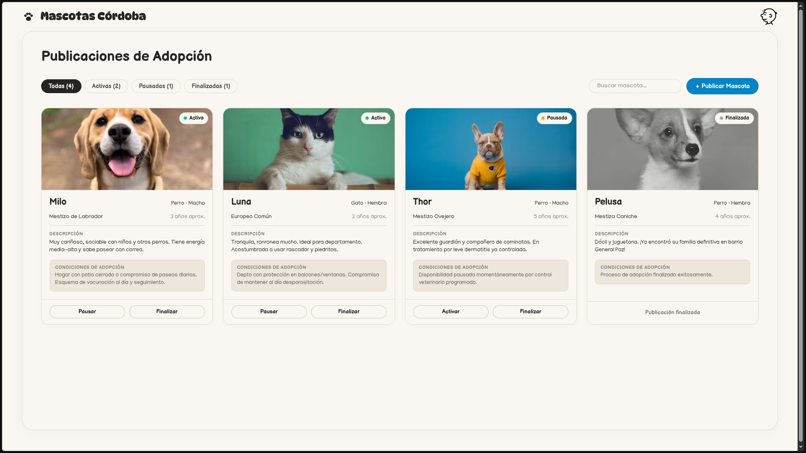
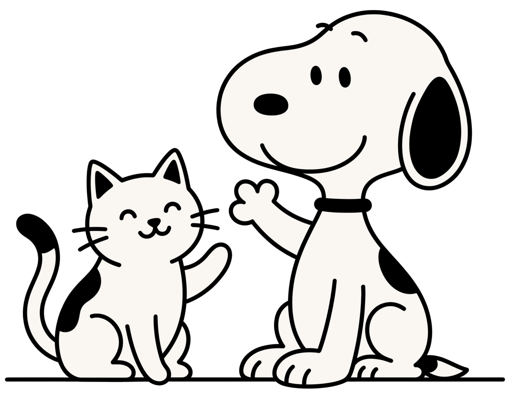
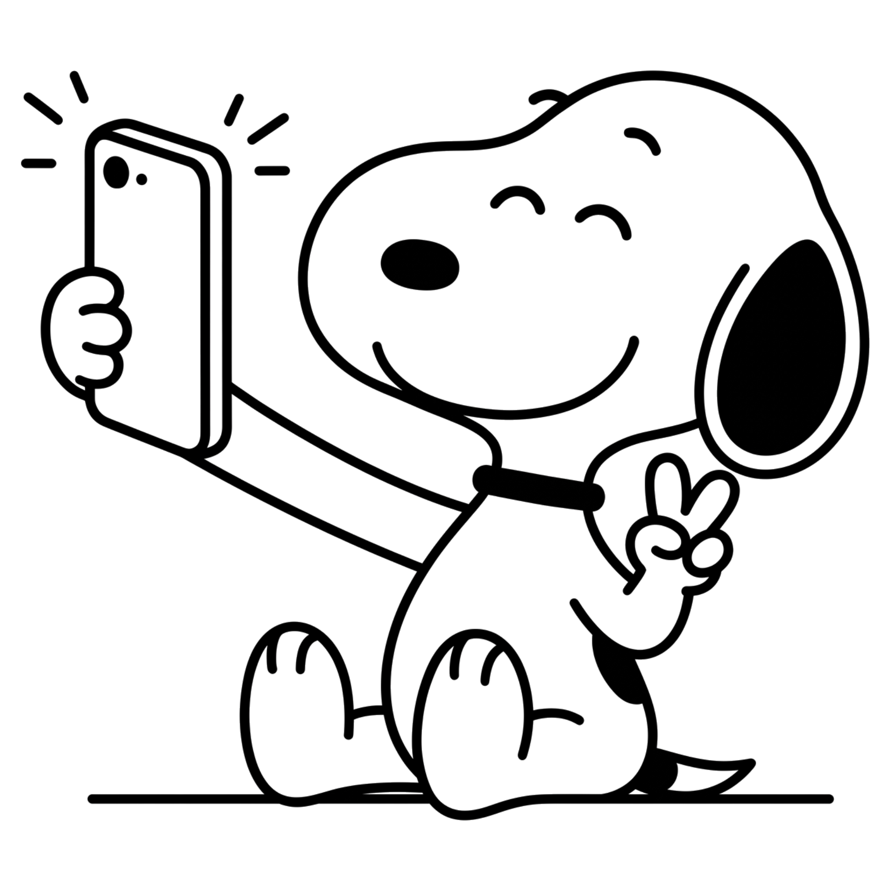

# Manual de Marca y Sistema de Diseño Web: Mascotas Córdoba
**Programa Municipal de Bienestar Animal — Municipalidad de Córdoba**  
*Cátedra: Diseño Avanzado de Software (DAS) · Edición Oficial 2026*  
*Formato de Documento: Scroll Vertical Continuo (Web & PDF)*

---

## 1. Uso Básico de la Marca: El Isotipo y sus Distintas Versiones

El símbolo visual corporativo de **Mascotas Córdoba** representa la huella de bienestar animal: una almohadilla plantar central elíptica acogedora rodeada armónicamente por cuatro almohadillas digitales en arco. Acompaña a la marca denominativa institucional transmitiendo afecto, rescate, tenencia responsable y protección integral comunitaria.

### 1.1 Las Cuatro Versiones Oficiales del Isotipo

| Versión | Construcción Visual | Aplicación Principal en Software | Tamaño Mínimo |
|---|---|---|---|
| **1. Versión Vertical (Apilada)** | Huella centrada de gran porte sobre la marca denominativa *"Mascotas Córdoba"* abajo. | **Portadas de documentos formales**, cartelería de CPCs, credenciales y splash screens. | Ancho: `80px` (digital) / `25mm` (impreso) |
| **2. Versión Horizontal** | Huella alineada a la izquierda + marca denominativa *"Mascotas Córdoba"* a la derecha en tipografía `DynaPuff`. | **Navbar institucional superior de la plataforma web**, cabeceras apaisadas y membretes digitales. | Ancho: `140px` (digital) / `35mm` (impreso) |
| **3. Versión Sigla / Reducida (Micro)** | Símbolo de huella concentrado con la sigla identificatoria *"MC"* en contenedor redondeado. | **Favicon de navegador** (`16x16`, `32x32`), ícono de PWA, avatares y micro-UI. | Ancho: `16px` (digital) / `6mm` (impreso) |
| **4. Isotipo con Lema (Tagline)** | Huella + *"Mascotas Córdoba"* + descriptor institucional *"Programa Municipal de Bienestar Animal"* en `Balsamiq Sans` / `Manjari`. | **Certificados oficiales**, resoluciones municipales, convenios con protectoras y pie institucional. | Ancho: `190px` (digital) / `50mm` (impreso) |

### 1.2 Área de Reserva (Clearspace "X") y Proporciones
- **Zona de exclusión perimetral**: El margen de protección libre de interferencias equivale a la altura **X** de la almohadilla plantar elíptica central de la huella.
- **Regla estricta**: Ningún elemento ajeno (texto, botón, borde divisor o gráfico secundario) puede invadir la zona de exclusión.
- **Espaciado web**: Se traduce en un margen de respiración mínimo de `12px` en dispositivos móviles y `18px` en pantallas de escritorio.

### 1.3 Fondos Contrastantes Aprobados
- **Sobre Crema Lienzo (`#FAF7F2`)**: Huella en Celeste Principal (`#0284C7`) y texto en Carbón Cálido (`#262422`). Aplicación estándar.
- **Sobre Arena Suave (`#EDE6DC`)**: Idéntica aplicación cromática, conservando óptimo contraste visual.
- **Sobre Celeste Bruma (`#E0F2FE`)**: Huella en Celeste Principal (`#0284C7`) y texto en Carbón Cálido (`#262422`).
- **Sobre Carbón Cálido (`#262422`)**: Huella en Celeste Principal (`#0284C7`) y texto en Crema Lienzo (`#FAF7F2`). **Prohibido usar blanco puro**.

### 1.4 Restricciones Estrictas de Marca (Do's & Don'ts)
- **✓ Correcto**: Utilizar los archivos SVG vectoriales oficiales sin alterar las proporciones relativas.
- **✕ Prohibido**: Estirar, condensar o distorsionar la relación de aspecto del isotipo.
- **✕ Prohibido**: Rotar el isotipo en ángulos inclinados o arbitrarios.
- **✕ Prohibido**: Aplicar sombras paralelas duras, biseles, trazos (*strokes*) exteriores o resplandores de neón.
- **✕ Prohibido**: Cambiar la tipografía de la marca institucional por tipografías genéricas (Arial, Comic Sans, Roboto, Inter).

---

## 2. Paleta Cromática (Tokens de Color y Semántica)

> **⚠️ Regla de Oro Visual — Prohibición Estricta de Blancos y Negros Puros**:  
> Queda **terminantemente prohibido el uso de blanco puro (`#FFFFFF` / `rgb(255,255,255)`) y negro puro (`#000000` / `rgb(0,0,0)`)** en cualquier elemento de la interfaz. Los fondos y superficies claras utilizan **Crema Lienzo (`#FAF7F2`)**, mientras que los elementos de texto y contraste utilizan **Carbón Cálido (`#262422`)** y **Pizarra Cálida (`#5C5650`)**. Esto previene la fatiga visual por deslumbramiento lumínico y confiere a la plataforma una atmósfera cálida, descansada y comunitaria de protectora animal.

### 2.1 Fondos y Lienzos de Interfaz

| Token CSS | Nombre Oficial | HEX | RGB | Uso Principal |
|---|---|---|---|---|
| `--color-bg-canvas` | Crema Lienzo | `#FAF7F2` | `250, 247, 242` | **Fondo predominante** de la aplicación, contenedor ventana y superficies de lectura. Reemplazo del blanco puro. |
| `--color-bg-surface` | Crema Lienzo (Superficie) | `#FAF7F2` | `250, 247, 242` | Superficie de tarjetas de adopción, modales y formularios. |
| `--color-bg-muted` / `--color-bg-sand` | Arena Suave | `#EDE6DC` | `237, 230, 220` | **Fondo secundario un poco más oscuro** para contraste suave, divisores, cajas de condiciones y badges. |
| `--color-border-subtle` | Arena Borde Tenue | `#E2D9CC` | `226, 217, 204` | Bordes suaves de tarjetas, ventana contenedora y divisores. |
| `--color-border-strong` | Arena Borde Medio | `#CFC4B5` | `207, 196, 181` | Bordes de inputs de formulario en reposo y botones secundarios. |

### 2.2 Colores de Acento (Acción e Identidad Municipal)

| Token CSS | Nombre Oficial | HEX | RGB | Uso Principal |
|---|---|---|---|---|
| `--color-accent` | Celeste Principal | `#0284C7` | `2, 132, 199` | Color primario de acción (+ Publicar Mascota, logo institucional y focos interactivos). Sin resplandores. |
| `--color-accent-hover` | Celeste Interactivo | `#0369A1` | `3, 105, 161` | Estado hover, activo y foco interactivo de botones y enlaces de acento. |
| `--color-accent-soft` | Celeste Bruma | `#E0F2FE` | `224, 242, 254` | Fondos de selección, chips suaves, badges destacados y curva de fondo orgánica del login. |
| `--color-accent-light` | Celeste Tenue | `#F0F9FF` | `240, 249, 255` | Fondos de alerta y previsualizaciones ligeras. |

### 2.3 Tipografía y Contrastes Neutros Cálidos

| Token CSS | Nombre Oficial | HEX | RGB | Uso Principal |
|---|---|---|---|---|
| `--color-text-main` | Carbón Cálido | `#262422` | `38, 36, 34` | Títulos principales, nombres de mascotas y textos de máxima jerarquía. Reemplaza el negro puro. |
| `--color-text-muted` | Pizarra Cálida | `#5C5650` | `92, 86, 80` | Subtítulos, metadatos estructurados (especie, raza, edad) y descripciones. |
| `--color-text-subtle` | Topo Suave | `#8A837B` | `138, 131, 123` | Placeholders de formulario, textos deshabilitados y accesos de prueba discretos. |
| `--color-text-on-accent` | Crema Inverso | `#FAF7F2` | `250, 247, 242` | Texto sobre botones celestes u oscuros (nunca blanco puro). |

### 2.4 Estados Semánticos (Sistema Monocromático con Punto Indicador Dot)
Para evitar la contaminación visual provocada por etiquetas multicolores saturadas, todos los badges de estado utilizan fondo unificado en **Arena Suave (`#EDE6DC`)** con borde fino (`#E2D9CC`) y texto en Carbón Cálido. El estado se comunica mediante un **punto cromático indicador (Dot) de 8px**:

| Estado de la Publicación | Color del Dot | HEX | Significado Funcional en el Negocio |
|---|---|---|---|
| **Activa** | Verde Menta Salvia | `#10B981` | Mascota disponible inmediatamente para proceso de adopción responsable. |
| **Pausada** | Ámbar Cálido | `#F59E0B` | Disponibilidad suspendida temporalmente (evaluación médica veterinaria o postulación en curso). |
| **Finalizada** | Gris Ceniza Cálido | `#9CA3AF` | Proceso de adopción completado con éxito. La foto de la mascota pasa a escala de grises suave. |

---

## 3. Tríada Tipográfica Oficial

El sistema visual utiliza tres familias tipográficas con funciones estrictamente acotadas para equilibrar calidez comunitaria, identidad institucional y legibilidad técnica:

### 3.1 `DynaPuff` (Identidad Institucional — Uso Ultra-Restringido)
* **Estilo**: Display esponjosa, lúdica, redondeada e inflada.
* **Criterio de legibilidad**: Al ser una tipografía display de fantasía, su legibilidad es reducida en bloques de lectura continua e interfaces densas.
* **Uso reglamentario**: Se reserva **exclusivamente** para la marca denominativa institucional: el texto `"Mascotas Córdoba"`.
* **Prohibición estricta**: **Nunca debe emplearse** en títulos de pantallas, nombres de mascotas, botones, tablas ni textos de formularios.

### 3.2 `Balsamiq Sans` (Títulos de Pantalla, Encabezados & UI)
* **Estilo**: Manuscrita-geométrica suave, redondeada y de **alta legibilidad en pantalla**.
* **Uso reglamentario**:
  - Títulos principales de páginas (H1 a H6, ej: *Publicaciones de Adopción*, *Iniciar Sesión*).
  - Nombres de las mascotas en tarjetas y fichas (ej: *Milo*, *Luna*, *Thor*, *Pelusa*).
  - Textos de botones de acción (*+ Publicar Mascota*, *Pausar*, *Activar*, *Finalizar*).
  - Pestañas de filtros (*Todas*, *Activas*, *Pausadas*, *Finalizadas*) y badges de estado.
* **Pesos permitidos**: Regular 400 y Bold 700.

### 3.3 `Manjari` (Cuerpo de Lectura & Formularios)
* **Estilo**: Sans-serif humanista con curvatura orgánica sutil y ritmo de lectura sumamente descansado.
* **Uso reglamentario**:
  - Párrafos de descripción del animal y temperamento.
  - Condiciones de adopción y textos reglamentarios de tenencia responsable.
  - Tablas de metadatos (especie, raza, edad, sexo, fecha).
  - Campos de entrada de datos (inputs, selects, textareas y placeholders).
* **Pesos permitidos**: Regular 400 y Bold 700.

### 3.4 Escala Tipográfica en la Plataforma

| Elemento UI | Fuente Oficial | Tamaño (Rem / Px) | Peso | Line-Height |
|---|---|---|---|---|
| **Logotipo de Marca** | `DynaPuff` | `1.65rem` (26.4px) | Bold 700 | `1.0` |
| **Título Principal de Página (H1)** | `Balsamiq Sans` | `2.0rem` – `2.4rem` (32–38px) | Bold 700 | `1.2` |
| **Nombre de Mascota en Tarjeta (H2)** | `Balsamiq Sans` | `1.4rem` (22.4px) | Bold 700 | `1.25` |
| **Botones de Acción** | `Balsamiq Sans` | `0.92rem` (14.7px) | Bold 700 | `1.0` |
| **Pestañas de Filtros (Tabs)** | `Balsamiq Sans` | `0.88rem` (14.0px) | Bold 700 | `1.0` |
| **Cuerpo de Texto / Párrafos** | `Manjari` | `0.95rem` (15.2px) | Regular 400 | `1.5` |
| **Caja de Condiciones** | `Manjari` | `0.85rem` (13.6px) | Regular 400 | `1.4` |
| **Campos de Entrada (Formularios)** | `Manjari` | `0.95rem` (15.2px) | Regular 400 | `1.45` |
| **Metadatos y Badges** | `Balsamiq Sans` / `Manjari` | `0.78rem` – `0.82rem` (12.5–13px) | Bold 700 | `1.0` |

---

## 4. Reglas de Diseño y Creación Web: Aplicación en la Plataforma Actual

Esta sección detalla cómo fueron aplicadas las reglas de diseño dentro de la arquitectura web actual del software:

### 4.1 Arquitectura del Lienzo y Ventana Contenedora
* **El Contenedor Ventana (95% × 90%)**: La aplicación implementa un contenedor centralizado respirable (`.canvas-card`) que ocupa el **95% del ancho de pantalla (95vw)** y el **90% de la altura visual (90vh)**, con esquinas redondeadas (`--radius-lg: 16px` o `24px`) y borde sutil en Arena Tenue (`#E2D9CC`), generando una sensación de ventana integrada cálida sobre el fondo general.
* **Navbar Minimalista Unificado**: A la izquierda exhibe el isotipo horizontal en `DynaPuff` enlazado al inicio. A la derecha, un avatar circular despliega una tarjeta flotante de 24px de radio con los datos del refugio: razón social, CUIL, habilitación municipal y botón de cierre de sesión (cumpliendo el requerimiento RF15 de sesión interna sin proveedores externos).

### 4.2 Comparativa: Prototipo Original (`prototipo_2.png`) vs. Estado Actual de la Página Principal
El análisis comparativo entre el diseño conceptual de la pantalla principal y su implementación en producción evidencia:

1. **Reglas del Prototipo Conservadas Fielmente**:
   - **Marco Ventana Flotante:** Contenedor respirable (95% × 90%) en Crema Lienzo (`#FAF7F2`).
   - **Grilla de 4 Columnas:** Distribución simétrica para tarjetas de adopción.
   - **Caja de Condiciones en Arena Suave (`#EDE6DC`):** Fondo diferenciado para requisitos de patio y esterilización responsable sin usar colores de peligro.
   - **Filtros por Pestañas (Pill):** Píldoras con contadores entre paréntesis para segmentar por estado.
   - **Publicación Finalizada en Escala de Grises:** Tratamiento fotográfico con `filter: grayscale(100%) opacity(0.85)` y mensaje pacífico "Publicación finalizada" sin botones de acción.

2. **Optimizaciones y Reglas Aplicadas en la Aplicación Actual**:
   - **Botón Primario `+ Publicar Mascota`:** Incorporado en la barra superior de comandos junto al buscador en Celeste Institucional (`#0284C7`), garantizando acceso directo al alta (RF13).
   - **Búsqueda en Vivo Multicriterio:** Input reactivo con lupa que filtra en tiempo real por nombre, especie o raza.
   - **Reactividad Angular Dinámica:** Los contadores de pestañas se recalculan automáticamente en vivo según los registros del refugio.
   - **Dropdown Institucional del Refugio:** Menú flotante al hacer clic en el avatar que expone Razón Social, CUIL y Habilitación Municipal (RF15).

### 4.3 Anatomía de la Tarjeta de Adopción (`.pet-card`)
La tarjeta de mascota resuelve el **RF13 (Gestionar Publicaciones de Adopción)** estructurándose de la siguiente forma:
1. **Fotografía Superior**: Encuadrada con `object-fit: cover` y esquina superior derecha con badge de estado dot flotante.
2. **Nombre & Taxonomía**: Nombre en `Balsamiq Sans` (22px), acompañado de especie y sexo en `Manjari bold`.
3. **Metadatos**: Raza y edad calculada automáticamente a partir del año de nacimiento registrado.
4. **Descripción**: Temperamento, origen y convivencia en `Manjari`.
5. **Caja de Condiciones**: En fondo Arena Suave (`#EDE6DC`) destacando obligaciones de patio y seguimiento.
6. **Pie con Botones de Estado**: Botones en cápsula para transicionar entre *Pausar*, *Finalizar* o *Activar*.
7. **Regla de Transición a Finalizada**: Al transicionar a Finalizada, la fotografía aplica `filter: grayscale(100%) opacity(0.85)` y los botones de acción se ocultan, simbolizando con ternura que el animal ya encontró su hogar definitivo.

### 4.4 Geometría, Sistema de Componentes UI y Microinteracciones
* **Tokens de Radios de Curvatura**:
  - `--radius-sm` (6px): Inputs, selects y campos de entrada de datos.
  - `--radius-md` (10px): Agrupadores internos, cajas de condiciones y modales secundarios.
  - `--radius-lg` (16px / 24px): Tarjetas de mascotas, dropdown de usuario y ventana contenedora principal.
  - `--radius-pill` (9999px): Botones de acción, badges de estado y pestañas de filtro.
* **Botones de Acción**: Botón primario en cápsula con Celeste Institucional (`#0284C7`), botones secundarios y de cambio de estado en Arena Borde (`#E2D9CC` / `#CFC4B5`).
* **Campos de Formulario**: Inputs y selectores con tipografía `Manjari`, borde suave y foco interactivo en Celeste Institucional sin glow excesivo.
* **Sombras Cálidas**: Sutiles y cálidas (`rgba(38, 36, 34, 0.04)`), con elevación suave en hover (`rgba(38, 36, 34, 0.06)`). Prohibidas sombras negras duras.
* **Microinteracciones (Cero Distracciones)**: Transiciones sutiles de `150ms ease` en hover y foco de teclado. Quedan terminantemente prohibidas las animaciones automáticas en bucle, marquesinas en movimiento o efectos de rebote (bounce).

---

## 5. Ilustraciones en la Página: Tipo, Estética y Lineamientos

### 5.1 Tipo de Ilustraciones y su Rol en el Software
La plataforma cuenta con dos ilustraciones emblemáticas diseñadas con un estilo **viñeta / historieta de trazo lineal cálido** (*cartoon hand-drawn line art* inspirado en Snoopy / Peanuts):

1. **Ilustración de Bienvenida en Inicio de Sesión (`ilustracion-login.png`)**:
   
   
   
   - **Ubicación**: Pantalla de autenticación (`prototipo_1.png` / `app/pages/refugio/login`).
   - **Personajes y Contenido**: Un cachorro amigable (personaje canino estilo Snoopy con collar oscuro) y un gatito sonriente celebrando afectuosamente la adopción responsable con un choque de manos / patitas.
   - **Tratamiento y Opacidad**: Se presenta al **100% de opacidad**, anclada en la base inferior derecha de la pantalla y conviviendo armónicamente con la onda orgánica en Celeste Bruma (`#E0F2FE`) y la huella central flotante.
   - **Objetivo**: Generar una recepción emotiva, humana y acogedora para los administradores del refugio al iniciar su jornada laboral.

2. **Ilustración Guía de Carga (Empty State) en Formulario de Alta (`ilustracion-foto.png`)**:
   
   
   
   - **Ubicación**: Dropzone de fotografía del formulario de alta (`prototipo_3.png` / `app/pages/refugio/publicacion-form`).
   - **Personaje y Contenido**: El cachorro estilo Snoopy sentado en el suelo tomándose una selfie con smartphone y haciendo el gesto de la paz ✌️.
   - **Tratamiento y Regla de Oro de Opacidad**: Se muestra estrictamente al **25% de opacidad** (`opacity: 0.25`).
   - **Objetivo y Criterio UX**: Al tratarse de un estado vacío (*empty state*), la baja opacidad funciona como una guía visual sutil (*affordance* y *signifier*) que invita a subir la imagen sin competir con la foto real ni confundir al usuario haciéndole creer que ya se ha cargado un archivo. Al seleccionar o arrastrar una imagen real, la ilustración desaparece instantáneamente y la fotografía de la mascota se previsualiza al 100%.

### 5.2 Estética Visual de las Ilustraciones
* **Estilo Gráfico**: Viñeta tradicional o historieta de trazo lineal continuo (*cartoon line art*), inspirado en la nobleza y calidez gráfica de tiras cómicas clásicas (Peanuts / Snoopy).
* **Morfología de Trazos**: Líneas redondeadas, orgánicas y fluidas en Carbón Cálido (`#262422`). Quedan prohibidos los vértices agresivos o ángulos puntiagudos.
* **Manchas de Relleno**: Figuras en Crema Lienzo (#FAF7F2) con manchas sólidas en Carbón Cálido (#262422) y detalles en Celeste Bruma (#E0F2FE), comunicando pureza, juego, ternura y protección integral de perros y gatos.

### 5.3 Lineamientos Técnicos y Prohibiciones Estrictas
Cualquier nueva ilustración que se incorpore en futuras etapas del Programa Municipal de Bienestar Animal debe cumplir estrictamente con los siguientes estándares:
* **Canal Alfa Obligatorio**: Formato **PNG en alta resolución (mínimo 1200px) con transparencia pura** o **SVG vectorial nativo**, evitando parches cuadrados o fondos blancos opacos sobre los lienzos crema o celestes.
* **Temática**: Rescate animal, convivencia multiespecie armónica, cuidado veterinario, tenencia responsable y juego.
* **Prohibiciones Terminantes**:
  - **Prohibido estilo "Corporate Memphis":** Queda terminantemente prohibido el estilo corporativo genérico de figuras humanas hiper-desproporcionadas con pieles azules o violetas y extremidades elásticas.
  - **Prohibido 3D hiperrealista:** No se admiten modelados 3D plásticos ni texturas fotorrealistas que desentonen con la estética de refugio comunitario.
  - **Prohibido colores neón:** Ningún gráfico puede incluir gradientes fluorescentes, púrpuras chillones o efectos de resplandor artificial que distraigan la operativa del refugio.

---

## 6. Documento Autónomo de Entrega
La versión web autónoma completa en formato de scroll vertical continuo se encuentra disponible en:
> **[`docs/manual-de-marca.html`](file:///home/gabel/Documents/Mascotas%20Cordoba%20-%20DAS/docs/manual-de-marca.html)**

Para imprimir o generar un PDF reglamentario, abra el archivo en cualquier navegador web y presione `Ctrl + P` (Guardar como PDF). La hoja de estilos para impresión se ajusta automáticamente sin barras de navegación ni cortes abruptos.
